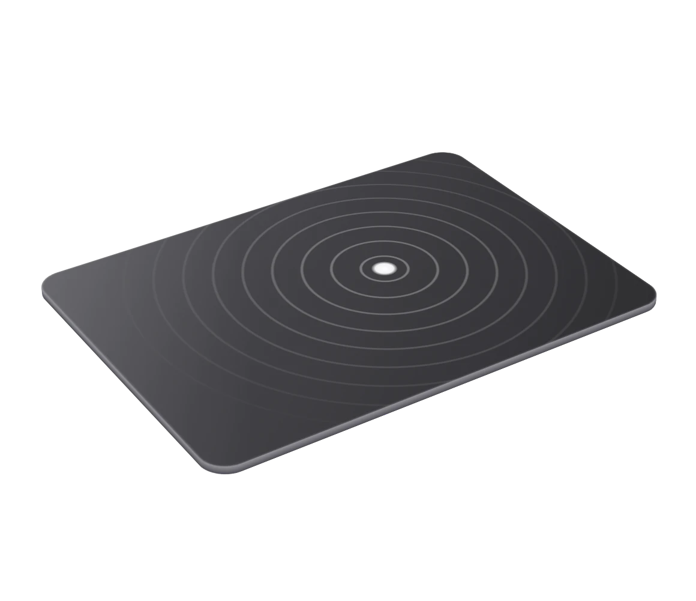
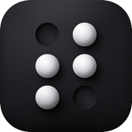

<table>
  <tr>
    <td align="center" width="50%">
       
      <b>Trackpad</b>
    </td>
    <td align="center" width="50%">
       
      <b>Logitech MX Master 4</b>
    </td>
  </tr>
</table>

# Tactile

**Feel the interface, not just see it.**

A macOS menu-bar app that ticks your trackpad or haptic mouse when the cursor
reaches something clickable, in any app. An accessibility aid: you *feel*
buttons and links instead of hunting for a hover color.

### [Download the latest release](https://github.com/Mason363/Tactile/releases/latest)

[Chrome extension](https://chromewebstore.google.com/detail/bkpkcddffbjipobgjlagggbbldefpldo?utm_source=item-share-cb) · [Demo on YouTube](https://www.youtube.com/watch?v=uhJYkYtZ8AE)

https://github.com/user-attachments/assets/b410fdf5-21cd-40d7-971e-5c15e5669e02

## Visual aids

https://github.com/user-attachments/assets/39e714b6-001d-41fa-ad16-dd00278f0ac2

**Crosshair.** Makes the pointer easy to find.

https://github.com/user-attachments/assets/3d63dd16-311b-4e34-bc6e-0c753deea56e

**Labels.** Name what you are over and where it lives.

https://github.com/user-attachments/assets/be978b1a-c9f5-4f8b-85c8-eac8164a2af8

**Element highlight.** Outlines the exact control under the cursor.

https://github.com/user-attachments/assets/32005d36-5cf8-4fb2-bb97-1f0e5bf81fd9

**Hover circle.** Green over clickable, red over destructive.

Turn these on in Settings → Visual Aids.

## Features

**Feel what you point at**

- **Works everywhere.** Apps, Finder, the Dock, the menu bar, and browsers.
- **Waveforms.** Give each kind of control its own feel. Pick a preset, tap
  one out, or draw it on a timeline.
- **Context.** Close and Delete play a warning. Checked boxes and the selected
  tab add a pulse.
- **Space.** Feel screen edges, window borders, and leaving a control.
- **Vibration.** With enhanced haptics, the trackpad hums while the cursor
  rests on a control.
- **Keyboard.** Tick on shortcuts, keys, or combos you record.
- **Chrome extension (optional).** Catches web buttons the system can't see.
  [Get it](https://chromewebstore.google.com/detail/bkpkcddffbjipobgjlagggbbldefpldo?utm_source=item-share-cb) or read the [source](extension/).

**Feel sound**

- **Feel the music.** The trackpad plays the notes your Mac is playing. It
  stays still for talk and pauses for calls.
- **Sound alerts.** Calls ring on the trackpad until you switch to them.
  Notifications and the charger have their own feel.

**Make it yours**

- **Profiles.** Save setups, switch from the menu bar, share them as JSON.
- **Playground.** Try your settings on sample controls.
- **Options.** Per-app exclusions, rate limit, dwell delay, No Lag mode, click
  sound, launch at login, and one-click pause.
- **Languages.** English and 简体中文. [Add your own](docs/localization.md).

## Where you feel it

- **Trackpad.** Any Force Touch trackpad, built in or a Magic Trackpad.
  Enhanced haptics make Light, Standard, and Firm truly different strengths.
  Have several? Pick which one ticks.
- **Logitech MX Master 4.** Ticks play under your thumb, over the Logi Bolt
  receiver. No Logitech software, no extra permission.
- **iPhone, via [Coast](https://coast.masn.studio).** When your phone is the
  mouse, ticks play in your hand.

Feedback follows your hand: the mouse while you point with it, the trackpad
while a finger is on it. Trackpad-only mode keeps it quiet while a mouse moves
the cursor. If your device is asleep or away, the trackpad takes over.

## Accessibility

- **Low vision.** Feel, color, and shape all mark the same event, so you get
  three signals instead of one.
- **Hard of hearing.** Sound becomes touch. Calls ring, notifications knock,
  the charger ramps up, and music plays under your finger.

Turn these on in Settings → Visual Aids, Alerts, and Music.

## Install

1. Download `Tactile.app` from the [latest release](https://github.com/Mason363/Tactile/releases/latest)
   and drag it to `/Applications`.
2. Open it and allow Accessibility when asked. The icon sits in the menu bar.

Tactile is notarized by Apple, so it opens with no workaround. It updates
itself with [Sparkle](https://sparkle-project.org).

For web pages, add the [Chrome extension](https://chromewebstore.google.com/detail/bkpkcddffbjipobgjlagggbbldefpldo?utm_source=item-share-cb)
(or [build it from source](extension/README.md)) and turn on **Browser
integration** in Settings → Apps & Browser.

## Requirements

- macOS 14.6 or later.
- A Force Touch trackpad, or a Logitech MX Master 4 on its Logi Bolt receiver.
  Other mice can use the click sound.
- The **Accessibility** permission. Tactile walks you through it.
- The **System Audio Recording** permission, for Feel the Music only. Tactile
  asks when you turn it on.

## How it works

Tactile reads the same Accessibility tree VoiceOver uses. It asks the system
what is under the cursor and ticks once when you enter something clickable.

Mouse still: 0% CPU. Mouse moving: under a few percent of one core.

## Privacy

- **No network of its own.** Only the Sparkle update check to this
  repository. No analytics, no telemetry.
- **Kind, never content.** Accessibility tells Tactile what *kind* of thing is
  under the cursor (button, link, …), never your content or keystrokes.
- **Music is heard, never recorded.** Audio is analyzed live, in memory.
  Nothing is stored or sent. Alerts see which apps are playing and that a
  banner appeared, never what it says.
- **Local links only.** The browser bridge and the Coast link are local
  sockets on this Mac. Any networking to the phone is Coast's. The mouse gets
  ticks, and Tactile never reads its movement, buttons, or keys.
- **Auditable.** A few private functions (trackpad motor, finger contact,
  audio permission check, audio helper matching) load at runtime and fall
  back safely. The rest is public API, and all the source is here.

## Building

Open `Tactile.xcodeproj` in Xcode and run. The system-wide Accessibility API
needs an unsandboxed app, so Tactile ships notarized instead of on the App
Store. Release steps are in [`docs/releasing.md`](docs/releasing.md).

## License

[MIT](LICENSE) © Mason Chen
