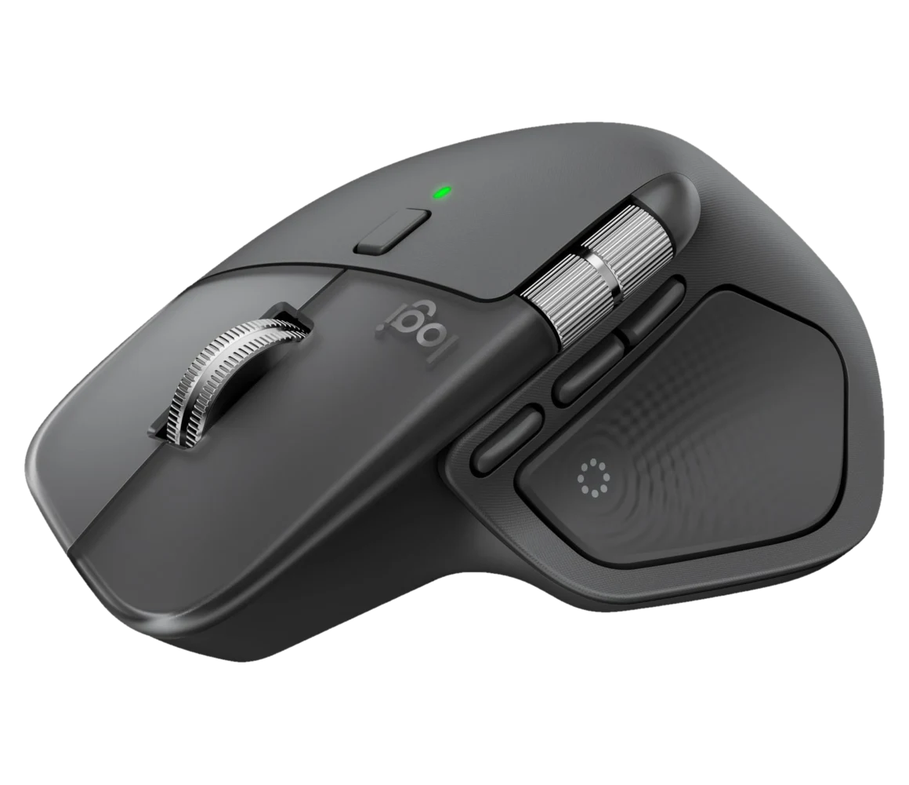

# Tactile

**Feel the interface, not just see it.**

Tactile is a macOS menu-bar utility that taps your trackpad's haptic motor, or a
haptic mouse, whenever the cursor passes over something clickable, in any app.
Built as an accessibility aid: instead of spotting a subtle hover color, you
*feel* a tick when the cursor reaches a button, link, checkbox, menu, or tab.

### [Download the latest release](https://github.com/Mason363/Tactile/releases/latest)

[Chrome extension](https://chromewebstore.google.com/detail/bkpkcddffbjipobgjlagggbbldefpldo?utm_source=item-share-cb) · [Demo on YouTube](https://www.youtube.com/watch?v=uhJYkYtZ8AE)

https://github.com/user-attachments/assets/b410fdf5-21cd-40d7-971e-5c15e5669e02

## Features

**Feedback on everything you point at**

- **Works everywhere.** Native apps, Finder, the Dock and menu bar, browsers,
  and Electron apps: anything with an accessibility tree.
- **Waveforms.** Every feel is a waveform, per element type. Pick a preset
  (taps, ramps, shake, heartbeat, ring) or make your own: tap a rhythm out by
  hand, or click pulses onto a timeline and drag them into shape. A pulse is a
  tap or a held note with its own pitch and length.
- **Context.** Close buttons and controls labeled Delete, Remove, or Reset play
  a warning. Checked boxes and the selected tab add a pulse, and disabled
  controls can feel dull.
- **Space.** A feel on leaving a control, at the screen edges, and across
  window boundaries.
- **Continuous vibration.** With enhanced haptics, the trackpad holds a real
  note while the cursor rests on a control: steady, pulses, or a heartbeat, at
  a pitch you choose.
- **Keyboard.** Tick on shortcuts, every key, modifiers, or combinations you
  record, each with its own waveform.
- **Chrome bridge (optional).** A [companion extension](https://chromewebstore.google.com/detail/bkpkcddffbjipobgjlagggbbldefpldo?utm_source=item-share-cb)
  reads the page itself, so `
` buttons that never reach the accessibility
  tree still tick. Source in [`extension/`](extension/).

**Sound you can feel**

- **Feel the music.** The trackpad plays what your Mac is playing: the music's
  own notes, up to five at once, following its loudness. Talk and podcasts stay
  still, it pauses during calls, and it lines up with your speakers or
  Bluetooth headphones on its own.
- **Sound alerts.** A FaceTime, Zoom, or Teams call rings on the trackpad until
  you switch to it. Other apps, notification banners, and the charger each
  have their own feel.

**Yours to tune**

- **Profiles.** Save your whole setup, switch from the menu bar, and share it
  as JSON.
- **Playground.** Sample controls to feel your settings live.
- **The usual knobs.** Per-app exclusions, rate limiting, dwell delay, No Lag
  mode, an optional click sound (built in or your own), launch at login, and
  one-click pause.
- **Languages.** English and Simplified Chinese (简体中文). Adding one is a
  resource folder: see [`docs/localization.md`](docs/localization.md).
- **Updates.** Automatic, via [Sparkle](https://sparkle-project.org).

## Where you feel it

<table>
  <tr>
    <td align="center" width="50%">
       
      <b>Trackpad</b>
    </td>
    <td align="center" width="50%">
       
      <b>Logitech MX Master 4</b>
    </td>
  </tr>
</table>

- **Trackpad.** Any Force Touch trackpad, built in or a Magic Trackpad.
  Enhanced haptics (optional) drive the motor directly, so Light, Standard, and
  Firm are physically different strengths, and fall back to standard haptics
  if ever unavailable. With several trackpads, pick which one ticks.
  Trackpad-only mode stays quiet while an external mouse moves the cursor.
- **Logitech MX Master 4.** Every tick plays through the motor under your
  thumb. Tactile drives the mouse directly over its Logi Bolt receiver, with no
  Logitech software and no extra permission. Feedback follows your hand: the
  mouse while you point with it, the trackpad while a finger is on it.
- **iPhone, via [Coast](https://coast.masn.studio).** When the phone is your
  mouse, every tick plays in your hand through its Taptic Engine.

Whenever the chosen device is asleep or away, feedback returns to the trackpads.

## Accessibility

Tactile doubles as a low-vision aid. Together with the tick, its visual aids
give three independent signals for the same event: feel, color, and shape.

- **Element highlight.** An outline traces the exact control under the cursor.
- **Crosshair.** A large crosshair makes the pointer easy to find.
- **Hover circle.** A circle rides under the cursor: green over clickable, red
  over destructive. Colors are configurable.
- **Labels.** A small label names the hovered element's type (link, button,
  toggle) and where it lives (menu bar, app, Dock).

For hard-of-hearing users, sound becomes touch: a call rings on the trackpad
until you switch to its app, notification banners knock, the charger ramps up,
and music is felt as it plays.

Turn these on in Settings → Visual Aids, Alerts, and Music.

**Crosshair**

https://github.com/user-attachments/assets/39e714b6-001d-41fa-ad16-dd00278f0ac2

**Crosshair and label**

https://github.com/user-attachments/assets/3d63dd16-311b-4e34-bc6e-0c753deea56e

**Element highlighting**

https://github.com/user-attachments/assets/be978b1a-c9f5-4f8b-85c8-eac8164a2af8

**Hover circle**

https://github.com/user-attachments/assets/32005d36-5cf8-4fb2-bb97-1f0e5bf81fd9

## Install

1. Download `Tactile.app` from the [latest release](https://github.com/Mason363/Tactile/releases/latest)
   and drag it to `/Applications`.
2. Launch it and grant the Accessibility permission when asked. The icon lives
   in the menu bar.

Tactile is notarized by Apple, so it opens with no Gatekeeper workaround.

For richer coverage on web pages, add the [Chrome extension](https://chromewebstore.google.com/detail/bkpkcddffbjipobgjlagggbbldefpldo?utm_source=item-share-cb)
(or [build it from source](extension/README.md)) and turn on **Browser
integration** in Settings → Apps & Browser.

## Requirements

- macOS 14.6 or later.
- A Force Touch trackpad (built in on modern MacBooks, or a Magic Trackpad), or
  a Logitech MX Master 4 on its Logi Bolt receiver. Other mice can use the
  click sound.
- The **Accessibility** permission (System Settings → Privacy & Security →
  Accessibility). Tactile walks you through it on first launch.
- For Feel the Music only: the **System Audio Recording** permission (System
  Settings → Privacy & Security → Screen & System Audio Recording, under System
  Audio Recording Only). Tactile asks when you turn it on.

## How it works

Tactile reads the same Accessibility tree VoiceOver uses. A global mouse monitor
watches the cursor, a background hit-tester asks the system what is under it,
and when the cursor enters a clickable element, the device ticks once.

Everything is event-driven: with the mouse still, Tactile does nothing at all
(0% CPU). While moving, sampling is throttled and cached per element, so
continuous use stays under a few percent of one core.

## Privacy

- **No network of its own.** The only outbound request is the Sparkle update
  check to this repository. No analytics, no telemetry, nothing collected.
- **Kind, never content.** The Accessibility permission is used only to
  identify the *kind* of element under the cursor (button, link, …), never
  your content or keystrokes.
- **Music is heard, never recorded.** Feel the Music analyzes system audio
  live, in memory, and only while something plays; nothing is stored or sent.
  Sound alerts read only which apps are playing, and notification haptics
  notice that a banner appeared, never what it says.
- **Local links only.** The browser bridge and the Coast link are local Unix
  sockets on this Mac; any networking to the phone is Coast's, not Tactile's.
  The mouse is reached over its own vendor channel (HID++): Tactile sends it
  ticks and reads only the answers to its own requests, never its movement,
  buttons, or keys.
- **Auditable.** The few private functions (the trackpad actuator and
  finger-contact frames, the System Audio Recording permission check, and
  matching an audio helper to its app) are loaded at runtime with `dlopen` and
  fall back safely. Everything else is public API, and the whole source is
  here.

## Building

Open `Tactile.xcodeproj` in Xcode and run; the Sparkle package resolves on its
own. The app is unsandboxed because the system-wide Accessibility API requires
it, so it ships with Developer ID signing and notarization instead of the App
Store. Maintainers: the release steps are in [`docs/releasing.md`](docs/releasing.md).

## License

[MIT](LICENSE) © Mason Chen
